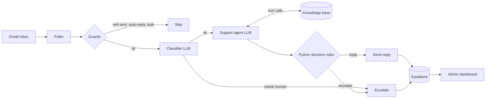

# AI Customer Support Agent

An autonomous customer support agent for an e-commerce store. It reads incoming emails from a Gmail inbox, classifies them, looks up answers in a policy knowledge base through tool calls, and either sends a grounded reply or hands the email to a human. Every decision is saved, tested against a set of golden emails, and visible in an admin dashboard.

> The model proposes, the code decides. LLMs draft and classify, but plain Python makes the final reply-or-escalate call.

## Features

- **Gmail integration:** polls the inbox with the Gmail API (OAuth 2.0), replies in the same thread, and labels every email it handles.
- **Two-stage LLM pipeline:** one LLM stage classifies each email, then an agent stage drafts the reply. Each stage has its own configurable model.
- **Tool calling:** the agent reads the knowledge base through tools instead of guessing from memory.
- **Structured output:** every model response is validated against Pydantic schemas.
- **Guardrails:** filters for self-sent, auto-responder and bulk mail, output validators with automatic retries, escalation rules, and deterministic Python rules for replacement decisions.
- **Human escalation:** sensitive or unsupported emails get a short acknowledgement, a `needs-human` label, and a proposed next step on the ticket.
- **Reliable processing:** each Gmail message is claimed once through a unique ID, failed messages are retried up to 3 times, and one bad email never stops the poller.
- **Evals:** 18 golden emails (including a non-English email and a prompt-injection attempt) check every classification and reply-or-escalate decision.
- **Admin dashboard:** a React dashboard to view events and tickets, read conversations, trigger a poll, and edit the knowledge base live.

## How it works



1. The **poller** checks Gmail every `POLL_INTERVAL_SECONDS` and picks up new mail. Handled emails get an `ai-processed` label.
2. **Guards** in plain Python skip emails the bot must not answer.
3. The **classifier** assigns a knowledge base section, detects the customer's language, and applies the always-escalate rules.
4. The **support agent** (a second LLM stage) reads the relevant knowledge base sections through tools and returns a structured `AgentReply`.
5. **Python rules** check the draft (missing information, promised actions, replacement rules) and make the final call.
6. The reply is sent in the same Gmail thread, and the event, ticket and messages are stored in Supabase.

### Escalation rules

The email is handed to a human when the customer:

- is angry, threatens a bad review, or uses abusive language
- asks for a refund, money back, or a chargeback
- asks for a person, a manager, or a phone call
- asks about the status of one specific order
- mentions an injury, a safety problem, or a lawyer
- sends attachments
- tries to give the bot instructions or asks it to ignore its rules
- asks about something the knowledge base does not cover

## Tech stack

| Area | Technology |
| --- | --- |
| Language | Python 3.13 |
| Backend | FastAPI, uv |
| AI | Pydantic AI, Groq-hosted LLMs, tool calling, structured output, `pydantic_evals` |
| Database | Supabase (PostgreSQL), Supabase CLI migrations |
| Email | Gmail API with OAuth 2.0 |
| Dashboard | React, TypeScript, Vite, Tailwind CSS, shadcn/ui |

## Project structure

```
.
├── app/
│   ├── ai/
│   │   ├── schemas.py        # Pydantic models for classification, agent reply, decision
│   │   ├── classifier.py     # classifier stage: section, language, needs_human
│   │   ├── agent.py          # agent stage + knowledge base tools + output validator
│   │   ├── rules.py          # deterministic replacement rules
│   │   └── decide.py         # combines everything into one final decision
│   ├── config.py             # settings loaded from .env
│   ├── db.py                 # database helpers (events, tickets, messages, knowledge base)
│   ├── gmail.py              # Gmail client: list, read, label, reply in thread
│   ├── guards.py             # skip rules for self-sent, auto-reply and bulk mail
│   ├── pipeline.py           # handles one email end to end
│   ├── poller.py             # separate process that polls Gmail on an interval
│   └── main.py               # FastAPI app: health check, dashboard API, static dashboard
├── dashboard/                # React admin dashboard
├── evals/
│   ├── golden_emails.py      # 18 test emails with expected section and action
│   └── run_evals.py          # runs the pipeline against the golden set
├── knowledge_base/           # six Markdown files seeded into Supabase
├── playground/
│   └── try_pipeline.py       # test one email without Gmail
├── scripts/
│   └── seed_knowledge_base.py
└── supabase/migrations/      # database schema
```

## Database

Four tables, all with row level security enabled:

| Table | Purpose |
| --- | --- |
| `events` | one row per Gmail message, with status (`processing`, `processed`, `skipped`, `failed`), attempts and result |
| `tickets` | one row per Gmail thread, with category, status (`open`, `answered`, `escalated`) and proposed action |
| `messages` | incoming and outgoing messages linked to a ticket |
| `knowledge_base` | one row per entry, grouped by section |

The backend connects directly as the `postgres` user. The dashboard never talks to Supabase directly.

## Getting started

### Prerequisites

- Python 3.13 and [uv](https://docs.astral.sh/uv/)
- Node.js 22 or later
- A **new** Gmail account for testing (do not use a personal inbox)
- A Google Cloud project with the Gmail API enabled and OAuth 2.0 credentials
- A [Supabase](https://supabase.com) project and the Supabase CLI
- A [Groq](https://console.groq.com) API key (Pydantic AI reads it from the environment; any provider Pydantic AI supports also works)

### 1. Clone and install

```bash
git clone https://github.com/samyaktotuka/ai-customer-support.git
cd ai-customer-support
uv sync
```

### 2. Configure the environment

Create a `.env` file in the project root:

```env
GOOGLE_CLIENT_ID=<oauth client id>
GOOGLE_CLIENT_SECRET=<oauth client secret>
GOOGLE_REFRESH_TOKEN=<oauth refresh token>
DATABASE_URL=postgresql://postgres.<project-ref>:<password>@aws-0-<region>.pooler.supabase.com:5432/postgres
DATABASE_PASSWORD=<supabase database password>
GROQ_API_KEY=<your groq api key>
CLASSIFIER_MODEL=groq:openai/gpt-oss-20b
AGENT_MODEL=groq:openai/gpt-oss-20b
POLL_INTERVAL_SECONDS=30
DASHBOARD_USERNAME=<username>
DASHBOARD_PASSWORD=<long random password>
PYDANTIC_AI_NO_BANNER=1
```

Never commit `.env`; make sure it is listed in `.gitignore`. Use the Supabase **session pooler** connection string (port 5432). The models are set in `.env`, so you can use a different model for each stage without code changes. The default setup uses `openai/gpt-oss-20b` on Groq for both.

### 3. Create the database

```bash
supabase login
supabase link --project-ref <project-ref>
supabase db push
```

### 4. Seed the knowledge base

```bash
uv run python -m scripts.seed_knowledge_base
```

Running the script again updates existing rows. It also overwrites edits made in the dashboard, so edit in the dashboard after the first seed.

### 5. Run the system

Use two terminals.

```bash
# Terminal 1: API and dashboard backend
uv run fastapi dev app/main.py

# Terminal 2: poller (restarts on code or .env changes)
uv run watchfiles "python -m app.poller" app .env
```

Send an email to the demo Gmail address and watch the poller logs. Only run one poller per inbox, otherwise two pollers can answer the same email.

### 6. Run the dashboard

```bash
cd dashboard
npm install
npm run dev
```

Open the address Vite prints (usually `http://localhost:5173`) and log in with `DASHBOARD_USERNAME` and `DASHBOARD_PASSWORD`. For a built version, run `npm run build`; FastAPI serves `dashboard/dist` when it exists.

## Testing without email

The playground sends one question straight to the pipeline, with no Gmail and no reply sent:

```bash
uv run python playground/try_pipeline.py
```

Edit the `question` variable in the file to try other emails.

## Evals

The eval set runs 18 golden emails through the pipeline and checks two things for each: the knowledge base **section** and the **action** (`reply` or `escalate`).

```bash
uv run python -m evals.run_evals
```

Cases include board sizing, a slow leak before and after the valve check, a cracked shelf panel, a wrong finish, a refund demand, an order status question, a request for a human, a German-language email, an unknown topic, and a prompt-injection attempt.

Run the evals after every prompt or knowledge base change. Model output varies between runs, so a case that flips often points to a rule that needs to be clearer. Fix the general rule instead of copying the test email into the prompt.

## Design decisions

- **Polling instead of webhooks:** polling only makes outgoing calls, so no domain, public URL or open port is needed. Webhooks make sense for instant replies or high volume.
- **The poller is a separate process:** several API workers would create several pollers, and the synchronous Gmail client would block the API.
- **Code makes the final call:** the agent reports facts in a structured `Issue`; Python decides what happens next (reply, ask for details, propose a shipment, or escalate).
- **Guards run before any model call:** this prevents reply loops with the bot's own mail or other auto-responders.
- **Knowledge base in a table:** one row per entry, so adding a section is new data, not a new migration, and the agent reads sections through tools.

## Limitations and next steps

- There is no order system, so nothing ships automatically. The proposed action is saved on the ticket for a colleague to carry out.
- The knowledge base is small (20 entries across six sections) and retrieved by section, not by semantic search. Larger knowledge bases would need vector search.
- A production version would add webhooks, a queue, monitoring, and cost tracking.

## Author

**Samyak Totuka**
[LinkedIn](https://www.linkedin.com/in/samyak-totuka) · [GitHub](https://github.com/samyaktotuka)
